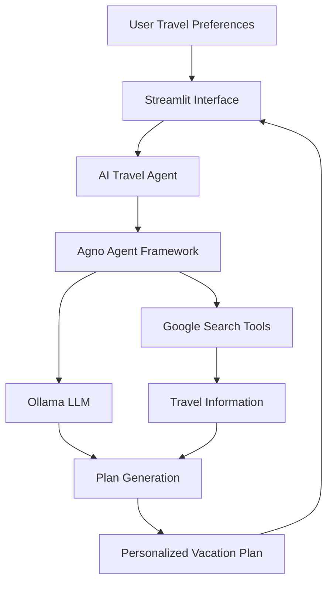

# ✈️ Vacation Planner Agent AI

### Your AI-Powered Travel Planning Assistant 🌍

An intelligent AI agent that helps users plan personalized vacations by generating travel suggestions and organizing trip information based on their preferences.

Built with Python, Agno, Streamlit, and Ollama, this project explores how AI agents and web search tools can work together to simplify travel planning.

## ✨ Features

- 🤖 **AI-Powered Planning:** Generate personalized vacation plans using an AI agent.
- 🔎 **Web Search Integration:** Gather relevant travel information using Google Search Tools.
- 🗺️ **Destination Discovery:** Explore destinations and travel recommendations.
- 📅 **Itinerary Generation:** Organize travel ideas into a structured vacation plan.
- 🧠 **LLM Integration:** Use Ollama to run a supported language model locally.
- 💻 **Interactive Interface:** Interact with the planner through a Streamlit application.
- 🐍 **Python-Based:** Built using Python and AI agent development tools.

## 🛠️ Tech Stack

| Technology | Purpose |
|---|---|
| Python | Core application logic |
| Agno | AI agent creation and orchestration |
| Ollama | Local language model runtime |
| Google Search Tools | Web-based information retrieval |
| Streamlit | Interactive user interface |

## 🏗️ Architecture



## 🚀 Getting Started

### Prerequisites

- Python 3.10 or a compatible version
- Git
- Ollama
- A language model supported by your application
- Any required search-tool configuration

### 1. Clone the Repository

```bash
git clone https://github.com/NadiaNorbert/Vacation_planner_Agentai.git
cd Vacation_planner_Agentai
```

### 2. Create a Virtual Environment

```bash
python -m venv .venv
```

Activate it on Windows:

```powershell
.venv\Scripts\Activate.ps1
```

### 3. Install Dependencies

If your repository includes a `requirements.txt` file:

```bash
pip install -r requirements.txt
```

### 4. Configure Ollama

Install Ollama and download the language model configured in your project.

For example, if your application uses Llama 3.2:

```bash
ollama pull llama3.2
```

Make sure the model name matches your application's configuration.

### 5. Configure Environment Variables

If your project uses environment variables, create a `.env` file and add the required configuration.

Never commit API keys, credentials, or other secrets to GitHub.

### 6. Run the Application

If your Streamlit entry point is `app.py`:

```bash
streamlit run app.py
```

Use the actual entry-point filename if it differs.

## 💡 Example Use Case

**Example user request:**

> Plan a 5-day vacation to Kerala with a moderate budget. Include scenic destinations, local food experiences, and nature activities.

The agent can use the available tools and language model to gather relevant information and generate a structured travel plan.

*Actual capabilities and results depend on the tools and features implemented in the repository.*

## 🧠 Concepts Demonstrated

- AI agents and tool calling
- Large Language Model integration
- Search-augmented information retrieval
- Prompt engineering
- Python application development
- Streamlit UI development
- Local LLM experimentation

## 🔮 Future Enhancements

- Flight and hotel search integrations
- Budget estimation and expense breakdowns
- Weather-aware itinerary recommendations
- Multi-agent collaboration
- Interactive maps and location-based suggestions
- Saving and exporting travel itineraries

## 👩‍💻 Author

**Nadia Norbert**

Computer Science Student | AI/ML Developer | Python Developer

- GitHub: [NadiaNorbert](https://github.com/NadiaNorbert)
- Repository: [Vacation Planner Agent AI](https://github.com/NadiaNorbert/Vacation_planner_Agentai)

---

*Exploring the possibilities of AI agents for smarter, personalized travel planning.*
